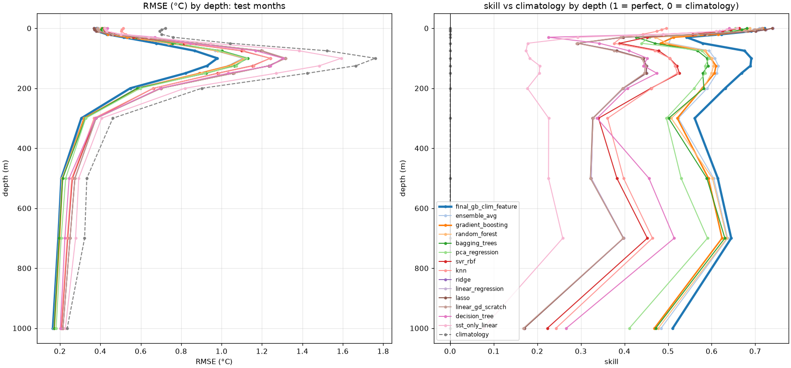
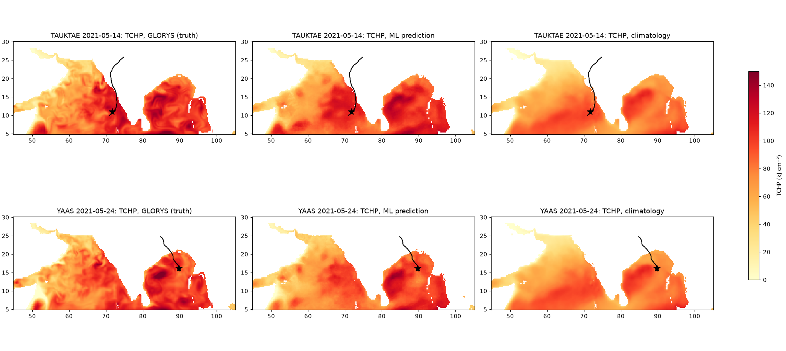
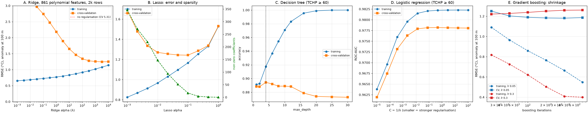
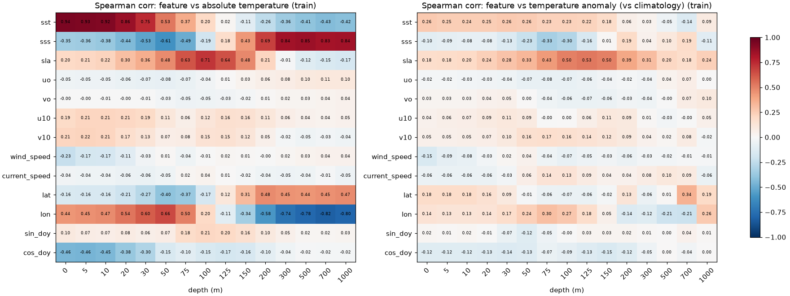

# OceanEmbed-ML: Subsurface Ocean Temperature from Satellite Surface Data using Machine Learning

> End-semester project for **CSE2032 Machine Learning** (BML Munjal University, 2026-27). The problem is aligned with a problem statement published by **INCOIS, Ministry of Earth Sciences**.

We reconstruct ocean temperature at **15 depths (0–1000 m)** over the **North Indian Ocean** from what satellites see at the surface: sea surface temperature, salinity, sea level, currents and winds.

The project applies the machine-learning methods of the CSE2032 syllabus (regression, regularization, classification, ensembles, PCA, cross-validation) to a real geoscience problem, with a strong focus on leakage-free evaluation.

---

## Project status

| Phase | What | Status |
|---|---|---|
| 0 | Problem and dataset audit | ✅ Complete: [inventory](docs/dataset_inventory.md) |
| 1 | Data download (6.8 GB, all files verified) | ✅ Complete: [details](docs/phase1_acquisition.md) |
| 2 | Harmonisation onto one common grid (11,880 ocean cells × 365 days × 15 depths) | ✅ Complete: [details](docs/phase2_harmonisation.md) |
| 3 | Data cube + EDA + outlier/cyclone check | ✅ Complete: [details](docs/phase3_eda.md) |
| 4 | Feature engineering (40 features, PCA surface embedding) + ML tables | ✅ Complete: [details](docs/phase4_features.md) |
| 5 | 13 models compared with CV + test; ablations; final model **RMSE 0.579 °C, skill 0.64** | ✅ Complete: [details](docs/phase5_models.md) |
| 6 | Full test grid, **ARGO validation** (1,279 profiles), ocean indicators (D20, D26, TCHP, MLD, OHC) | ✅ Complete: [details](docs/phase6_evaluation.md) |
| **7** | **Classification** (cyclone-favourable ocean, TCHP ≥ 60) + **regularization** curves | ✅ **Complete**, awaiting approval: [details](docs/phase7_classification_regularization.md) |
| **8** | Report + presentation (CSE2032 formats) | ✅ **Done**: generated by `reports/build/` (the output files are kept out of the repository) |
| 9 | **Whole-project validation audit**: data integrity, harder tests, bootstrap CIs | ✅ Done: [details](docs/validation_audit.md) |
| 10 | **Interactive dashboard** (static website, GitHub Pages) | ✅ Done: [`dashboard/`](dashboard/), see below |

**Course checklist (CSE2032, 7 required components):** see [docs/course_requirements.md](docs/course_requirements.md). All 7 are covered.

**Live dashboard:** https://aryanbhutani14.github.io/Oceantemperatures/ (published from `dashboard/` by GitHub Actions).

## Dashboard

A static website in [`dashboard/`](dashboard/) with no server and no JS libraries. Sections:

- an ocean explorer: pick a test day, a depth and a field (temperature, TCHP, D20 or satellite inputs), compare GLORYS, the ML prediction, climatology and the error map, then click any cell to see its full profile against ARGO floats
- error by depth, region and season
- ARGO validation
- the May 2021 cyclones (Tauktae, Yaas)
- all 13 models compared
- an interactive classifier threshold

Every number comes from `dashboard/data/`, which is exported from the result files by:

```bash
.venv/Scripts/python scripts/09_export_dashboard.py   # writes dashboard/data/ (~12 MB)
.venv/Scripts/python -m http.server 8765 --directory dashboard   # preview at http://localhost:8765
```

---

## The problem

| | |
|---|---|
| **Region** | North Indian Ocean, 5°N–30°N, 45°E–105°E (Arabian Sea + Bay of Bengal) |
| **Grid** | 0.25° × 0.25° (101 × 241 cells, 11,880 of them ocean), daily |
| **Period** | 2021 (365 days) |
| **Inputs** | SST, SSS, sea-level anomaly, surface currents U/V, 10 m winds U/V |
| **Output** | Temperature at 0, 5, 10, 20, 30, 50, 75, 100, 125, 150, 200, 300, 500, 700, 1000 m |
| **Target ("truth")** | GLORYS ocean reanalysis |
| **Independent check** | 4,071 ARGO float profiles |
| **Train / test** | Test = whole months **Feb, May, Aug, Nov** (one per season); train = the other 8 months; 7-day buffers between them. **Never a random row split.** |

## Datasets

| Role | Dataset | Native resolution | Mapped to our grid by |
|---|---|---|---|
| Target | GLORYS reanalysis 0.25° (`GLOBAL_MULTIYEAR_PHY_ENS_001_031`) | 0.25°, daily, 75 levels | Exact match + linear interpolation to the 15 depths |
| Baseline | GLORYS12 monthly climatology (`GLOBAL_MULTIYEAR_PHY_001_030`) | 1/12°, monthly | 3×3 block mean |
| SST | OSTIA L4 (`SST_GLO_SST_L4_REP_OBSERVATIONS_010_011`) | 0.05°, daily | Area-weighted conservative; K → °C |
| SSS | SMOS/SMAP multi-obs L4 (`MULTIOBS_GLO_PHY_S_SURFACE_MYNRT_015_013`) | 0.125°, daily | 2×2 block mean |
| SLA + currents | DUACS L4 (`SEALEVEL_GLO_PHY_L4_MY_008_047`) | 0.125°, daily | 2×2 block mean |
| Winds | ASCAT-based L4 (`WIND_GLO_PHY_L4_MY_012_006`) | 0.125°, hourly | Daily mean → 2×2 block mean |
| Validation | ARGO floats (GDAC) | profiles | Nearest cell, same day |
| Events | IBTrACS North Indian cyclone tracks | n/a | Event-based evaluation only |

Full details: [docs/dataset_inventory.md](docs/dataset_inventory.md). All decisions: [docs/decisions.md](docs/decisions.md).

## Repository layout

```text
src/oceanembed_ml/        # reusable, importable package (pip install -e .)
  config.py               #   paths + config loading
  grid.py                 #   canonical grid, conservative regridder, vertical interpolation
  audit/                  #   Phase 0: catalogue queries, grid-alignment analysis
  data/                   #   Phase 1-3: download, verify, harmonise, build cube
  eda/                    #   Phase 3: statistics/figures, outlier vs cyclone screening
  features/               #   Phase 4: physics features (pure functions) + table builder
  models/                 #   Phase 5: model zoo, GD-from-scratch, metrics, CV/test, ablation, final model
  evaluation/ validation/ science/   # Phase 6: full-grid prediction, ARGO validation, ocean indicators
  classification/         #   Phase 7: TCHP >= 60 classification (6 classifiers + baselines)
  viz/                    #   figure helpers
scripts/                  # thin CLIs, one per phase: 00_audit.py ... 05_final_model.py, make_notebooks.py
notebooks/                # executed exploration notebooks (read outputs; no pipeline logic)
  01_data_audit.ipynb  02_harmonisation.ipynb  03_eda.ipynb  04_features.ipynb  05_models.ipynb  06_evaluation.ipynb  07_classification_regularization.ipynb
results/phase5/           # metrics JSON of every model (committed); fitted models go to models/ (git-ignored)
configs/                  # grid.yaml, datasets.yaml, features.yaml (single source of truth)
tests/                    # pytest: regridding, physics features, leakage checks
docs/                     # dataset inventory, decision log, one write-up per phase
reports/figures/          # generated figures (committed)
data/audit/               # small JSON outputs of every phase (committed)
data/raw|interim|processed|final/   # pipeline data (git-ignored, rebuilt by the scripts)
```

**Raw data never goes into GitHub.** Every phase is reproducible from the commands below, and its machine-readable summary is committed in `data/audit/`.

## Setup

```bash
python -m venv .venv
.venv/Scripts/pip install -e ".[data,dev]"        # Windows; use .venv/bin/ on Linux/macOS
```

Downloading needs a free [Copernicus Marine](https://data.marine.copernicus.eu) account. Log in once with `copernicusmarine login` (in PowerShell: `& ".venv/Scripts/copernicusmarine.exe" login`).

## Reproduce every phase

```bash
.venv/Scripts/python -m pytest -q                                # 21 tests: regridding, features, leakage, models, indicators
.venv/Scripts/python scripts/00_audit.py                         # Phase 0  catalogue audit (no login)
.venv/Scripts/python scripts/01_download.py cmems --source all   # Phase 1  ~6.8 GB, resumable
.venv/Scripts/python scripts/01_download.py argo
.venv/Scripts/python scripts/01_download.py verify
.venv/Scripts/python scripts/02_harmonise.py --source glorys     # Phase 2  target + masks first
.venv/Scripts/python scripts/02_harmonise.py --source all
.venv/Scripts/python scripts/02_plots.py
.venv/Scripts/python scripts/03_build_cube.py                    # Phase 3  data cube + split labels
.venv/Scripts/python scripts/03_eda.py
.venv/Scripts/python scripts/04_features.py                      # Phase 4  features -> Parquet
.venv/Scripts/python scripts/05_models.py                        # Phase 5  CV selection + test, 13 models (~2 h, SVR is slow)
.venv/Scripts/python scripts/05_ablation.py                      #          feature/target/data-size ablations
.venv/Scripts/python scripts/05_final_model.py                   #          target chosen by CV + final model
.venv/Scripts/python scripts/05_plots.py
.venv/Scripts/python scripts/06_evaluate.py                      # Phase 6  full test grid, ARGO, indicators, figures
.venv/Scripts/python scripts/07_classification.py                # Phase 7  classification + regularization curves
.venv/Scripts/python scripts/08_audit.py                         # audit: integrity checks, harder tests, bootstrap CIs
.venv/Scripts/python scripts/09_export_dashboard.py              # dashboard data (dashboard/data/)
cd reports/build && npm install && python trim_figures.py && node build_deck.js && node build_report.js   # report + slides (numbers read from results/*.json)
.venv/Scripts/python scripts/make_notebooks.py                   # re-execute notebooks
```

## Results (Phase 5): test months Feb/May/Aug/Nov, identical 200k rows

All models are chosen by **GroupKFold-by-month cross-validation on the train months**; the test months were only used for the final scoring.

| Model (CSE2032 topic) | Test RMSE °C | Skill vs climatology | RMSE at 100 m |
|---|---|---|---|
| Climatology (baseline) | 0.999 | 0.00 | 1.76 |
| SST-only linear (baseline) | 0.862 | 0.31 | 1.59 |
| Linear Regression / Ridge / Lasso | 0.738 | 0.45 | 1.31 |
| **Linear Regression by gradient descent (from scratch)** | 0.743 | 0.44 | 1.32 |
| Decision Tree | 0.743 | 0.45 | 1.30 |
| KNN (k = 40) | 0.721 | 0.44 | 1.24 |
| SVR (RBF) | 0.702 | 0.48 | 1.24 |
| PCA regression (8 vertical modes + boosting) | 0.653 | 0.56 | 1.12 |
| Bagging | 0.651 | 0.57 | 1.13 |
| Random Forest | 0.639 | 0.59 | 1.11 |
| Gradient Boosting (selected family) | 0.634 | 0.59 | 1.12 |
| ✅ **Final: Gradient Boosting + climatology feature** | **0.579** | **0.64** | **0.98** |

- **Best model's error by depth:** 0.38 °C at the surface, **0.98 °C in the thermocline (100 m)**, 0.17 °C at 1000 m.
- **Bias:** every ML model removes the climatology's −0.32 °C bias (2021 was warmer than the long-term mean).



### Independent validation against real ARGO floats (Phase 6)

1,279 float profiles on test days, never used for training:

| vs ARGO | RMSE °C | Bias °C |
|---|---|---|
| Climatology | 1.119 | −0.42 |
| **ML model** | **0.718** | **−0.05** |
| GLORYS (assimilates ARGO; upper bound) | 0.599 | 0.00 |

The model closes **77%** of the gap between the climatology and GLORYS.

### Ocean indicators (vs GLORYS)

| Indicator | ML error | Climatology error |
|---|---|---|
| Thermocline depth D20 | **10.9 m** | 20.6 m |
| Cyclone heat potential TCHP | **9.5 kJ cm⁻²** (r 0.97) | 19.8 kJ cm⁻² |
| Upper-ocean heat content (0–300 m) | **0.51 GJ m⁻²** | 1.06 GJ m⁻² |



### Classification: is the ocean favourable for cyclone intensification? (TCHP ≥ 60 kJ cm⁻², Phase 7)

| Model | Accuracy | F1 | Recall | ROC-AUC |
|---|---|---|---|---|
| Climatology rule (baseline) | 0.821 | 0.775 | 0.663 | n/a |
| Decision Tree | 0.904 | 0.899 | 0.919 | 0.947 |
| KNN | 0.922 | 0.918 | 0.934 | 0.977 |
| **Logistic Regression L1** (selected by CV) | 0.926 | 0.922 | 0.936 | 0.983 |
| SVM (RBF) | 0.929 | 0.924 | 0.927 | 0.984 |
| Random Forest | 0.930 | 0.926 | 0.932 | 0.985 |
| Gradient Boosting | **0.937** | **0.932** | 0.934 | **0.987** |

**Regularization:** an 861-feature model overfits (train RMSE 0.60 °C vs CV 5.31 °C). Ridge brings CV to 1.25 °C, and Lasso keeps only 17 of the 861 features.



### How realistic are these numbers? (validation audit)

The main test is optimistic: the model trains on the months around each test month. Harder tests give the realistic error:

| Test | RMSE °C | Climatology °C | Skill |
|---|---|---|---|
| Main (whole months held out) | 0.58 | 1.00 | 0.64 |
| Unseen regions | 0.70 | 1.14 | 0.53 |
| Unseen months ahead | 0.80 | 1.02 | 0.37 |
| **Unseen months and regions** | **0.87** | 1.16 | **0.33** |

- **Classifier:** accuracy is 93% overall but only **67%** for cases within ±10 kJ cm⁻² of the threshold.
- **Data checks:** processed data match the raw files exactly; no duplicates; no leakage symptoms.

Details: [docs/validation_audit.md](docs/validation_audit.md).

## Key findings

- **One regridding operator for every source** (area-conservative; unit-tested): identity for GLORYS, exact block means for nested grids, partial-cell weights for OSTIA.
- **Real extremes are kept, not deleted:**
  - Persian Gulf summer SST reaches 36.7 °C, so the plausibility cap is 38 °C.
  - SST extremes are **~10× more likely near 2021 cyclone tracks** than chance: they are cold wakes.
- **Sea level anomaly is the best predictor of the thermocline** (Spearman 0.71 with temperature at 100 m). **SST matters only in the top ~30 m.**
- After removing the climatology, the anomaly to learn peaks at **1.58 °C std at 100 m** (0.22 °C at 1000 m).
- **Derived features help:**
  - SST anomaly correlates 0.75 with the surface target anomaly (raw SST: 0.26).
  - The **PCA surface embedding** (8 components, 95% of patch variance) reaches −0.44 at 100 m.



## References

- Problem statement on subsurface temperature reconstruction, INCOIS (Ministry of Earth Sciences)
- Copernicus Marine Service products above (DOIs in [docs/dataset_inventory.md](docs/dataset_inventory.md))
- Argo (2000). Argo float data and metadata from the Global Data Assembly Centre (Argo GDAC). SEANOE. doi:10.17882/42182
- Knapp et al. (2010), IBTrACS. Bull. Amer. Meteor. Soc.
- Large & Pond (1981), drag coefficient for wind stress. J. Phys. Oceanogr.
